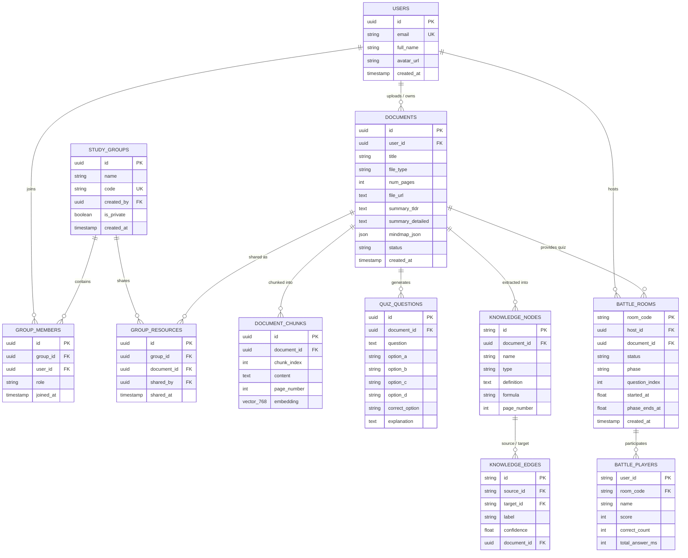

# [REPORT 2] DETAILED ARCHITECTURE & CORE FEATURE IMPLEMENTATION

**Course:** Cross-Platform Mobile App Development  
**Project Title:** DocuGraph AI – Trợ lý Học tập Thông minh & Tóm tắt Tài liệu Đa tầng (Multi-layer Knowledge Assistant & Smart Learning Platform)  
**Team Name:** DocuGraph Team (Nguyễn Quang Nhân) • **Academic Term:** Semester 1 (2026 - 2027) • **Deadline:** Week 8  

---

## 1. CLEAN ARCHITECTURE IMPLEMENTATION

DocuGraph AI tuân thủ nghiêm ngặt nguyên lý **Clean Architecture** (Robert C. Martin) và mô hình phân tách hướng tính năng (**Feature-First Modular Architecture**) nhằm đảm bảo tính độc lập, khả năng mở rộng, dễ kiểm thử và độc lập hoàn toàn giữa Business Logic cốt lõi với giao diện UI, cơ sở dữ liệu và thư viện bên thứ ba.

```
       +-------------------------------------------------------------+
       |                     PRESENTATION LAYER                      |
       |  - UI Screens & Expo Router: app/(tabs)/*, app/battle/*     |
       |  - State Management: Zustand 5.x & TanStack Query v5        |
       |  - UI Components: NativeWind v4, Lucide Icons, WebView      |
       +------------------------------+------------------------------+
                                      | calls use cases
                                      v
       +-------------------------------------------------------------+
       |                        DOMAIN LAYER                         |
       |  - Entities: DocumentEntity, OcrScanResult, BattlePlayer    |
       |  - Use Cases: ScanDocumentUseCase, AskQuestionUseCase, ...  |
       |  - Repository Interfaces: DocumentRepository, ScannerRepo   |
       |  - Functional Error Handling: Either<Failure, Success>      |
       +------------------------------+------------------------------+
                                      ^ implements interfaces
                                      |
       +------------------------------+------------------------------+
       |                         DATA LAYER                          |
       |  - Repositories: DocumentRepositoryImpl, ScannerRepoImpl    |
       |  - Remote Data Sources: FastAPI REST/SSE, Supabase Client   |
       |  - Local Data Sources: Expo SQLite, MMKV, AsyncStorage      |
       |  - Models / Mappers: DocumentModel, OcrScanModel            |
       +-------------------------------------------------------------+
```

---

### 1.1. Presentation Layer (Tầng Trình diễn)
* **Công nghệ & Framework:** React Native (Expo SDK 52+, React Native 0.76+), Expo Router v4 (File-system Routing), NativeWind v4 (Tailwind CSS), Lucide React Native, Cytoscape.js Canvas qua `react-native-webview`.
* **Cấu trúc màn hình (`frontend/app/`):**
  * `(auth)/login.tsx`, `(auth)/register.tsx`: Đăng nhập/Đăng ký qua Supabase Auth và OAuth Google.
  * `(tabs)/index.tsx`: Home Dashboard tổng quan, hiển thị tài liệu gần đây, trạng thái offline, quick action tải file/quét camera.
  * `(tabs)/documents.tsx`: Quản lý Tủ sách cá nhân, phân loại tóm tắt, tìm kiếm, xóa tài liệu trực tiếp.
  * `(tabs)/chat.tsx`: Trợ lý GraphRAG tương tác thời gian thực, hiển thị trích dẫn trang nguồn và công thức toán học.
  * `(tabs)/groups.tsx`: Không gian Nhóm học tập, chia sẻ tài nguyên "Xử lý 1 lần - Zero Token", tạo phòng đấu trí từ tài liệu nhóm.
  * `(tabs)/battle.tsx`: Sảnh Đấu trí Trắc nghiệm nhiều người chơi (Tạo phòng chủ phòng hoặc nhập mã 6 số để vào).
  * `battle/[roomCode].tsx`: Màn hình Đấu trí Realtime đồng bộ theo đồng hồ server (Pha Chờ $\rightarrow$ Đếm ngược 3s $\rightarrow$ Làm bài 15s $\rightarrow$ Hiện đáp án 5s $\rightarrow$ Bảng vàng Podium).
  * `document/[id].tsx`: Trình đọc tóm tắt chuyên sâu (Executive Summary, Key Takeaways, Concept Graph 2D/3D).
* **State Management & Data Synchronization:**
  * **Zustand (`stores/authStore.ts`, `features/chat/chat_slice.ts`, `features/quiz/quiz_slice.ts`):** Quản lý trạng thái xác thực phiên làm việc, danh sách tin nhắn chat streaming, và trạng thái phòng thi đấu.
  * **TanStack Query (React Query v5):** Quản lý caching dữ liệu từ xa, tự động refetching khi có mạng, tối ưu re-render và hỗ trợ optimistic UI updates.

---

### 1.2. Domain Layer (Tầng Nghiệp vụ Cốt lõi)
* Tầng Domain là trung tâm của hệ sinh thái phần mềm, **hoàn toàn độc lập** với mọi thư viện ngoài (Zero UI, Zero HTTP, Zero Database imports), viết bằng TypeScript thuần.
* **Entities (Thực thể Nghiệp vụ):**
  * [`DocumentEntity`](file:///d:/HocTap/N4/DA_NEN_TANG/DocuGraph-Learning%20Support%20&%20Document%20Summary%20Assistant/frontend/src/features/documents/domain/entities/document_entity.ts): Đại diện cho tài liệu học tập (`id`, `title`, `fileType`, `numPages`, `summaryTldr`, `summaryDetailed`, `mindmapJson`, `status`, `createdAt`).
  * [`OcrScanResult`](file:///d:/HocTap/N4/DA_NEN_TANG/DocuGraph-Learning%20Support%20&%20Document%20Summary%20Assistant/frontend/src/features/scanner/domain/entities/ocr_scan_result.ts): Đại diện cho kết quả bóc tách OCR (`rawText`, `cleanedText`, `detectedTitle`, `detectedFormulas`, `detectedDates`, `confidence`, `latencyMs`).
* **Repository Interfaces (Hợp đồng Trừu tượng):**
  * [`DocumentRepository`](file:///d:/HocTap/N4/DA_NEN_TANG/DocuGraph-Learning%20Support%20&%20Document%20Summary%20Assistant/frontend/src/features/documents/domain/repositories/document_repository.ts): Khai báo các hợp đồng `getAllDocuments()`, `getDocumentById()`, `uploadDocument()`, `deleteDocument()`, `askQuestion()`.
  * [`ScannerRepository`](file:///d:/HocTap/N4/DA_NEN_TANG/DocuGraph-Learning%20Support%20&%20Document%20Summary%20Assistant/frontend/src/features/scanner/domain/repositories/scanner_repository.ts): Khai báo phương thức `recognizeTextFromImage()`, `dispose()`.
* **Use Cases (Các ca sử dụng nghiệp vụ cụ thể):**
  * [`ScanDocumentUseCase`](file:///d:/HocTap/N4/DA_NEN_TANG/DocuGraph-Learning%20Support%20&%20Document%20Summary%20Assistant/frontend/src/features/scanner/domain/usecases/scan_document_usecase.ts): Nhận diện chữ từ ảnh, tích hợp cơ chế throttling 400ms (2.5 FPS) bảo vệ phần cứng camera và pin điện thoại.
  * [`GetDocumentsUseCase`](file:///d:/HocTap/N4/DA_NEN_TANG/DocuGraph-Learning%20Support%20&%20Document%20Summary%20Assistant/frontend/src/features/documents/domain/usecases/get_documents_usecase.ts): Lấy danh sách tài liệu với cơ chế Single Source of Truth (SSOT).
  * [`GetDocumentDetailUseCase`](file:///d:/HocTap/N4/DA_NEN_TANG/DocuGraph-Learning%20Support%20&%20Document%20Summary%20Assistant/frontend/src/features/documents/domain/usecases/get_document_detail_usecase.ts): Lấy chi tiết tóm tắt và cấu trúc Mindmap JSON.
  * [`AskQuestionUseCase`](file:///d:/HocTap/N4/DA_NEN_TANG/DocuGraph-Learning%20Support%20&%20Document%20Summary%20Assistant/frontend/src/features/documents/domain/usecases/ask_question_usecase.ts): Gửi truy vấn GraphRAG đến backend kèm lịch sử hội thoại.
  * [`DeleteDocumentUseCase`](file:///d:/HocTap/N4/DA_NEN_TANG/DocuGraph-Learning%20Support%20&%20Document%20Summary%20Assistant/frontend/src/features/documents/domain/usecases/delete_document_usecase.ts): Xóa tài liệu đồng bộ cả server và local cache.
* **Functional Error Handling (`Either<Failure, Success>` Pattern):**
  * Thay vì sử dụng `throw new Error()` gây unhandled runtime crash, toàn bộ Use Cases trả về kiểu `Either<Failure, T>`.
  * Phân cấp Failure rõ ràng: `ServerFailure`, `CacheFailure`, `NetworkFailure`, `ValidationFailure`, `OcrFailure`, `AuthFailure`.
  * Khối UI tiêu thụ kết quả an toàn bằng phương thức `.fold(onLeft, onRight)`.

---

### 1.3. Data Layer (Tầng Dữ liệu)
* **Repository Implementations:**
  * [`DocumentRepositoryImpl`](file:///d:/HocTap/N4/DA_NEN_TANG/DocuGraph-Learning%20Support%20&%20Document%20Summary%20Assistant/frontend/src/features/documents/data/repositories/document_repository_impl.ts): Điều phối linh hoạt giữa Remote Data Source và Local Data Source thông qua `NetworkInfo`.
    * *Khi Online:* Gọi API backend qua HTTP/REST, đồng thời ghi đè cache xuống SQLite cục bộ.
    * *Khi Offline (Airplane Mode):* Tự động chuyển vùng sang SQLite, đọc toàn bộ tóm tắt và sơ đồ ngoại tuyến với độ trễ 0ms.
  * [`ScannerRepositoryImpl`](file:///d:/HocTap/N4/DA_NEN_TANG/DocuGraph-Learning%20Support%20&%20Document%20Summary%20Assistant/frontend/src/features/scanner/data/repositories/scanner_repository_impl.ts): Gọi Google ML Kit On-Device trước; nếu gặp ảnh chụp nghiêng/chữ mờ tiếng Việt sẽ fallback sang PaddleOCR trên Cloud.
* **Data Sources:**
  * **Remote:** `DocumentRemoteDataSource` (Axios Client với BaseURL FastAPI), Supabase Client (PostgreSQL, Auth, Realtime).
  * **Local:** `DocumentLocalDataSource` (Expo SQLite & MMKV/AsyncStorage), hàng đợi đồng bộ ngoại tuyến `OfflineSyncQueue`.
* **Dependency Injection & Service Locator (`sl`):**
  * Tệp [`src/core/di/injection_container.ts`](file:///d:/HocTap/N4/DA_NEN_TANG/DocuGraph-Learning%20Support%20&%20Document%20Summary%20Assistant/frontend/src/core/di/injection_container.ts) khởi tạo duy nhất các singleton và tiêm phụ thuộc ngược chiều (DIP), cho phép dễ dàng hoán đổi mock repository trong automated unit tests.

---

## 2. DATABASE SCHEMA & SECURITY POLICIES

DocuGraph AI ứng dụng kiến trúc cơ sở dữ liệu phân tán đa tầng kết hợp: **PostgreSQL + pgvector** (dữ liệu quan hệ và vector ngữ nghĩa), **Neo4j** (đồ thị tri thức thực thể), và **Supabase Auth / Realtime** (bảo mật và socket đồng bộ).

### 2.1. Visual Entity-Relationship Diagram (ERD)



---

### 2.2. Row-Level Security (RLS) Policies

Hệ thống kích hoạt tính năng **Row-Level Security (RLS)** trên toàn bộ các bảng trong PostgreSQL nhằm đảm bảo tính cô lập và bảo mật tuyệt đối cho dữ liệu của từng sinh viên:

```sql
-- 1. Kích hoạt RLS trên bảng DOCUMENTS
ALTER TABLE documents ENABLE ROW LEVEL SECURITY;

-- Chính sách: Người dùng chỉ được xem tài liệu do mình sở hữu HOẶC tài liệu được chia sẻ trong nhóm họ tham gia
CREATE POLICY "Users can access own documents or group documents"
ON documents FOR SELECT
USING (
    auth.uid() = user_id
    OR id IN (
        SELECT gr.document_id 
        FROM group_resources gr
        JOIN group_members gm ON gr.group_id = gm.group_id
        WHERE gm.user_id = auth.uid()
    )
);

-- Chính sách: Người dùng chỉ được thêm, sửa, xóa tài liệu do chính mình tạo
CREATE POLICY "Users can insert own documents"
ON documents FOR INSERT
WITH CHECK (auth.uid() = user_id);

CREATE POLICY "Users can update own documents"
ON documents FOR UPDATE
USING (auth.uid() = user_id);

CREATE POLICY "Users can delete own documents"
ON documents FOR DELETE
USING (auth.uid() = user_id);

-- 2. Kích hoạt RLS trên bảng DOCUMENT_CHUNKS (Vector Embeddings)
ALTER TABLE document_chunks ENABLE ROW LEVEL SECURITY;

CREATE POLICY "Users can access chunks of accessible documents"
ON document_chunks FOR SELECT
USING (
    document_id IN (
        SELECT id FROM documents WHERE auth.uid() = user_id
    )
);

-- 3. Kích hoạt RLS trên STUDY_GROUPS & GROUP_MEMBERS
ALTER TABLE study_groups ENABLE ROW LEVEL SECURITY;
ALTER TABLE group_members ENABLE ROW LEVEL SECURITY;

CREATE POLICY "Members can view their groups"
ON study_groups FOR SELECT
USING (
    id IN (
        SELECT group_id FROM group_members WHERE user_id = auth.uid()
    )
);

CREATE POLICY "Group creators can manage group"
ON study_groups FOR ALL
USING (auth.uid() = created_by);
```

---

## 3. CORE FEATURE IMPLEMENTATION PROGRESS

### 3.1. Deliverables & Repository Links
* **🔗 GitHub Repository (Branch `main`):** [https://github.com/nguyenquangnhan/Learning-Support-Document-Summary-Assistant---DocuGraph.git](https://github.com/nguyenquangnhan/Learning-Support-Document-Summary-Assistant---DocuGraph.git)
* **🔗 Interactive UI Prototype (Figma):** [https://www.figma.com/design/3w2qVF83r7LJyYs0xnCQR8/Untitled?node-id=0-1&t=Iac2gzgWqkgfIXO5-0](https://www.figma.com/design/3w2qVF83r7LJyYs0xnCQR8/Untitled?node-id=0-1&t=Iac2gzgWqkgfIXO5-0)
* **🎥 Milestone 2 Video Demo (Walkthrough 3–5 phút):** Đang cập nhật video demo thực nghiệm trên thiết bị Android/Web.

---

### 3.2. Detailed Feature Implementation Status

| # | Chức năng (Feature) | Tiến độ (%) | Trạng thái kỹ thuật | Mô tả chi tiết kỹ thuật đã hoàn thành |
|:---:|---|:---:|:---:|---|
| **1** | **Xác thực & Bảo mật (Auth & Security)** | 100% | **Hoàn thành** | Đăng nhập/Đăng ký qua Supabase Auth; lưu JWT Token an toàn với `SecureStore` & `MMKV`; tự động khôi phục phiên đăng nhập khi mở app. |
| **2** | **Quét OCR On-Device & Cloud** | 100% | **Hoàn thành** | Tích hợp Google ML Kit nhận dạng chữ thô tức thì (latency ~14ms); cơ chế Regex Heuristic tự bóc tách Tiêu đề, Công thức, Ngày tháng; Cloud PaddleOCR cho tài liệu tiếng Việt scan mờ. |
| **3** | **Tóm tắt Thông minh Đa tầng (AI Summarization)** | 100% | **Hoàn thành** | Tích hợp Gemini 2.5 Flash; xuất bản tóm tắt chuẩn Markdown gồm TL;DR, Key Takeaways, thuật ngữ cốt lõi và trích dẫn số trang tài liệu nguồn. |
| **4** | **Trực quan hóa Đồ thị Tri thức (Concept Graph)** | 100% | **Hoàn thành** | Trích xuất Nodes & Edges từ tài liệu nạp vào Neo4j; render trực quan 2D/3D trên `react-native-webview` với Cytoscape.js; hỗ trợ cử chỉ zoom/pan/tap node xem định nghĩa. |
| **5** | **Trợ lý Chat Hỏi đáp GraphRAG** | 100% | **Hoàn thành** | Kết hợp tìm kiếm ngữ nghĩa `pgvector` và đồ thị thực thể Neo4j; phản hồi streaming trực tiếp kèm số trang đối chiếu; cam kết loại bỏ ảo giác (grounded citations). |
| **6** | **Quản lý Tủ sách & Xóa tài liệu** | 100% | **Hoàn thành** | Danh mục tài liệu với bộ lọc theo loại file; tính năng xóa tài liệu an toàn đồng bộ cả backend SQLite/PostgreSQL và bộ nhớ cache ngoại tuyến. |
| **7** | **Nhóm Học tập & Chia sẻ Tài nguyên** | 100% | **Hoàn thành** | Tạo nhóm với mã mời 6 chữ số; cơ chế "Xử lý 1 lần - Zero Token" giúp cả nhóm truy cập tức thì tóm tắt và sơ đồ mà không tốn thêm token AI. |
| **8** | **Đấu trí Trắc nghiệm Đồng bộ (Quiz Battle)** | 100% | **Hoàn thành** | Kiến trúc phòng Realtime: Chủ phòng tạo phòng nhận mã PIN 6 số; người chơi nhập mã vào phòng chờ; **duy nhất chủ phòng bấm Bắt đầu thì tất cả cùng chơi đồng thời 1 lúc** theo đồng hồ server; tính điểm tốc độ và vinh danh Top 3 Podium. |
| **9** | **Khả năng Hoạt động Ngoại tuyến (Offline-First)** | 100% | **Hoàn thành** | Bộ đệm SQLite & AsyncStorage lưu trữ toàn bộ tóm tắt và sơ đồ; tự động phát hiện mất mạng (`NetworkInfo`) và chuyển sang đọc offline không gián đoạn; hàng đợi `OfflineSyncQueue` tự đồng bộ khi có kết nối lại. |
